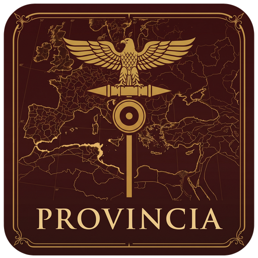

  

<h1 align="center">Provincia</h1>

<b>A living map and companion for Rome: Total War and its mods.</b> 
Watch your campaign unfold turn by turn - armies on the march, borders redrawn, treasuries and diplomacy shifting as you play.

  

Click the button above to get the installer (about 36 MB). It updates itself, so you only download it once.

---

## What it does

- **A map of the whole campaign** - every region, settlement and faction at a glance.
- **Follows your game live** - point it at your campaign and the map changes as you play.
- **Many map views** - owners, homelands, governments, diplomacy and more.
- **Works with your mods** - load the mod you play and Provincia reads it straight from the game.
- **Best alongside [RR Turbo](https://github.com/Tarnholm/Turbo)** - but it works without it too.

Provincia only reads your game. It never changes your game, your saves or your mods.

## How to install

1. **Download** the installer with the button above.
2. **Run it** and follow the steps.
3. **Open Provincia**, pick your mod and campaign, and play.

## Windows says "Windows protected your PC"?

Provincia is a small hobby project, so Windows doesn't know it yet. It is safe.
Click **More info**, then **Run anyway**. You only need to do this once.

## Good to know

- **Updates are automatic** - Provincia updates itself when a new version is out.
- **Uninstall** - Windows Settings > Apps > Installed apps > Provincia > Uninstall.

---

Made in the Nordics by Apple. 
Not made by or affiliated with Feral Interactive, SEGA or Creative Assembly. 
❤ Slava Ukraini!

